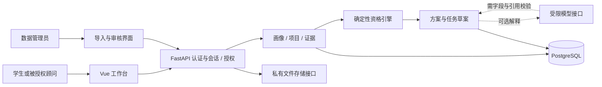

# 升学咨询智能体技术架构规划

2026-10-14 SEARCH-SELECT-01增加单体内reference_directory身份投影与共享前端选择组件。具体PublishedDirectoryReader包装T20当前正式CatalogReader，复用同engine/事务/当前发布证明、时限和水位，只返回学校/专业身份与有限出处；SQL搜索/去重分页，默认factory注入None不连接目录。两个旧reference工厂增加默认关闭GET，不改原production/M0/T20或后台治理；无新依赖/微服务/迁移，真实装配/SQL/运行未执行。身份与培养/毕业资料、三类年份分别处理，见[契约](school_program_search.md)及ADR-061。

2026-10-13 SCHEDULE-ANNUAL-01新增单体内ingestion/annual_updates独立维护入口：纯年度planner+显式CLI worker，PG维护请求快照/自然键去重；不挂FastAPI、不中断M0/浙江或扩展T36私有作业。默认关闭，旧T66不fetch；仅生成待采集请求，无模型/学生数据/事实发布能力。复用现有Pydantic/SQLAlchemy/Alembic与已有tzdata，无新框架；新维护库仅loopback/public，实际worker托管与迁移/运行未执行。设计见[年度调度](annual_source_updates.md)、ADR-060。

2026-10-12用户确认简化全部剩余任务并逐个执行至T67；T49不重复。本批按docs/simplified_plan.md交付最小源码，原运行/真实资料/发布验收保留未验证；D01/D07等未知不阻挡默认关闭源码顺序推进，但继续阻挡真实启用。此新授权替代先前T50停止及T44源码等待限制。不运行测试/Lint/TypeCheck/Build/校验/演练，每Task文档同步和PRIVATE普通保存后下一项，T67后停止。

2026-10-04 T42按用户‘先做通用Docker配置’完成本地隔离配置源码；实际城市/供应商/手续仍待定。仅production foundation/空目录、auth静态前端、TLS同源代理、私网业务库与独立卷台账库、显式维护迁移；私有业务/worker/live关闭。按‘不用测试’未执行测试/Lint/TypeCheck/Build/预检或容器演练，源码完成不表示运行通过。本批至T50授权保持；每Task文档同步及PRIVATE保存后再推进。

历史前置记录（同日后续用户选择通用源码，已由ADR-056调整）：2026-10-04 T42部署前置文档核对完成但Task [!] 阻塞：D01部署城市/供应商/适用备案流程未定，不能满足平台地域适配验收。只新增部署范围/待测矩阵与阻塞记录，没有Dockerfile/运行配置/采购或部署；Docker CLI29.8.1但Linux Engine当前不可达。T41已PRIVATE保存4009a36；T43–T50未开始，本批授权至T50保持，解除依赖后才恢复T42；真实处理关闭。见[阻塞记录](acceptance/T42_deployment.md)。

2026-10-04 T41隐私与授权操作页面源码与合成隔离验收完成：62新增前端专项/完整805、228相关Python、1实际PG/HTTP/Edge十一检查点、TypeCheck/双Build通过；[验收](acceptance/T41_privacy_workspace.md)。复用现有隐私/共享，默认折叠本人导出/删除，受理/失败/在线完成分开，原内容只内存并拒迟到；真实关闭。PRIVATE保存核对后才单独T42，本批T50停止，真实处理关闭。

2026-10-04 T40资料权利与独立删除台账源码与合成隔离验收完成：30新pure/11契约、18 distinct实际PG-HTTP含pg_dump/restore、713相关Python加1旧symlink skip、743前端/TypeCheck/双Build通过；[验收](acceptance/T40_data_rights.md)。本人导出/持久删除、备份外最小减权台账与完整性锚点，受理不等于完成，缺最新证明拒流量；真实处理关闭。PRIVATE保存核对后才单独T41，本批T50停止，真实处理关闭。

2026-10-04 T39有限公开证据问答入口源码与合成隔离验收完成：61新pure/9新契约/10 distinct实际PG-HTTP（含1 Edge八检查点）、704相关Python/143模式-M0、742完整前端及末59专项/TypeCheck/双Build通过；[验收](acceptance/T39_qa_entry.md)。默认disabled、固定意图/匿名实例预算与等待后当前证明，纯文本类型化引用；无真实模型/画像工具/DB迁移。PRIVATE保存核对后才单独T40，本批T50停止，真实处理关闭。

2026-10-04 T38范围检索与严格引用验证源码与合成隔离验收完成：106纯及评测校验、10 distinct实际PG、528相关Python/143模式-M0、684前端/TypeCheck/双Build通过；[验收](acceptance/T38_qa_retrieval.md)。仅当前已发布且精确适用的公开证明，等待后重新取证且整答拒伪引用；默认关闭、真实/live/HTTP/UI仍关闭。PRIVATE保存核对后才单独T39，本批T50停止，真实处理关闭。

2026-10-04用户新授权延长至T50：仍按单Task依赖/验收/文档同步/PRIVATE保存后逐个推进，完成T50停止；历史T40停止为旧批次记录，不撤销新授权。真实模型、真实学生、公众部署和事实发布门槛保留。

2026-10-04 T37可替换模型接口与离线预算源码与合成隔离验收完成：90新增离线/async专项、651相关Python/143模式-M0、684前端/TypeCheck/双Build通过；[验收](acceptance/T37_model_gateway.md)。真实live保持关闭，disabled无需密钥；合成mock只读有限接口与进程内预算，不改确定性资格或核心服务。PRIVATE保存核对后才单独T38，本批T50停止，真实处理关闭。

2026-10-04 T36持久作业与站内提醒源码与合成隔离验收完成：36新增pure/16实际PG-HTTP/12契约，684前端/TypeCheck/双Build通过；[验收](acceptance/T36_jobs_notifications.md)。新增五表/第16迁移head及默认关闭、本人确认的站内提醒；持久租约/fencing/去重/有界重试，接受清理仅probe，不做真实删除或外部通知。PRIVATE保存核对后才单独T37，本批T40停止，真实处理关闭。

2026-10-04 T35明确修订与有限历史工作台源码与合成隔离验收完成：57纯专项/19 distinct PG及HTTP/Edge、321契约与350相关Python、635前端/Type Check/双Build通过；[验收](acceptance/T35_plan_revisions.md)。仅复用本人明确选择的新草案，追加接受/拒绝与替代关系，旧确认/完成不改、新计划未最终确认；历史不表示当前资格，真实关闭。PRIVATE保存核对后才单独T36，本批T40停止，真实处理关闭。

2026-10-04 T34发布变更业务比较与影响追踪源码与合成隔离验收完成：86纯专项/16distinct PG、723相关Python/590前端、Type Check/双Build与八契约核对通过；[验收](acceptance/T34_changes.md)。仅处理已存发布事件的精确关系与不可变影响轨迹，不重算资格或改写计划完成；无新增HTTP/UI/worker，真实关闭。PRIVATE保存核对后才单独T35，本批T40停止，真实处理关闭。

2026-10-04 T33计划与进度工作台源码及合成隔离验收完成：116新增前端专项/完整590、56相关Python、Type Check/demo-auth Build及1真实PG/Edge用例通过；[验收](acceptance/T33_plan_workspace.md)。显式目标、UTC微秒/未知估时、独立确认/本人完成、只读历史与迟到清理保留；PRIVATE保存核对后单独T34，本批T40停止，正式处理关闭。

2026-10-04 T32确认与进度源码及合成隔离验收完成：56新增pure、28 distinct PG/HTTP、305契约回归、865相关旧Python、474前端与Type Check/demo-auth Build通过；[验收](acceptance/T32_plan_execution.md)。独立state_version与不可变记录、首次确认未来容量及重放当前进度保留，不改变资格/学校事实；PRIVATE保存核对后单独T33，本批T40停止，正式处理关闭。

2026-10-04 T31纯容量排程验收完成：100新增专项、228相关旧pure、474前端及Type Check/demo-auth Build通过；[验收](acceptance/T31_scheduling.md)。本地周容量/UTC整数工时、依赖与冲突保留，官方精确期限仍未知，原草案不确认。PRIVATE保存核对后才单独T32，本批T40停止；真实处理关闭。

2026-10-04 T30草案源码与合成隔离验收完成：81专项pure、23独立PG用例、641相关Python和474前端通过，Type Check/demo-auth Build通过；[验收](acceptance/T30_plan_drafts.md)。五表/内部服务保持draft与来源绑定，512KiB极端组合限额问题已记录；真实处理/HTTP/排程/确认关闭。按持续授权PRIVATE保存核对后再单独T31，本批到T40停止。

2026-10-04 T29已完成项目比较与证据工作台：474前端、529相关Python、2独立PG用例（其中实际Edge13检查点）及Type Check/demo-auth Build通过；[验收](acceptance/T29_catalog_workspace.md)。完整范围/权限和原证据文本保持；真实处理仍关闭。按持续授权PRIVATE保存核对后再单独执行T30，本批至T40停止。

2026-10-03 T28源码及合成隔离验收完成：33路径（11旧/22新）、513其他tracked保持；104纯四态、23新PG、63旧PG、284契约、764相关Python、348前端及Type Check/双Build。完整AST/必要后补义务、当前本人/原用途/最终期限、不可变结果与历史current_validity分开；正式规则仍unknown。基线PRIVATE T27 0f61760955f32d4822e637ec22ef41de23f17a97、524tracked/空索引，codex/t28-eligibility-assessments；无新依赖/旧迁移/M0改变，真实处理关闭。文档与PRIVATE保存核对后才T29，详见docs/acceptance/T28_assessments.md。

T27独立rules/deferral纯模块源码及合成离线验收完成，复用T12锁定日期计算和T26完整scope pin，受信政策证明默认不可用；无HTTP/DB/UI/依赖变更。见[契约](deferrals.md)。

T26新增rules/adapters纯范围与可替换绑定端口源码及合成离线验收完成，无HTTP/DB/UI/新依赖；现T19事实发布ruleset=null不编DSL。见[契约](scope_adapters.md)。

T25新增独立rules纯AST/解释器源码及离线验收完成，实施前冻结[规则契约](rules.md)。旧M0 eligibility/现服务保持，无数据库、HTTP或新依赖；范围选择/事项后补已由T26/T27补齐，四态由T28独立实现，正式规则仍未知。

T24工作台源码及合成隔离验收完成：ProfileView与profiles有界同源客户端/表单/状态复用T23契约；AuthView最小挂载和PrivacyPanel用途失效事件，无全局新store或后端改变。见[冻结契约](profile_workspace.md)。

## T23 私有画像模块（源码与合成隔离验收完成）

新增profiles服务复用Auth/Privacy/T49/最少审计，同engine/session当前证明；完整immutable确认版本与CAS，旧M0/五生成profile/技术栈及依赖保持。详见[契约](profiles.md)。

2026-10-03最新产品目标（ADR-034）：全部普通高考生源省份逐省配置，英国本科暂定2027、优先剑桥/曼彻斯特；真实省/年/专业适用证据未验收时unknown。下文旧单省描述为先前规划或M0基线，不表示当前产品目标或已实现覆盖。

## T22 人工工作台组合（已验收；真实处理关闭）

新admin_review facade复用T16–T21服务及同engine当前证明，UI分人工准备/独立审核/发布；另挂T20匿名只读，避免foundation路由覆盖。无新依赖/服务，真实处理默认关闭。详见[契约](admin_review_workspace.md)。

## T21 显式管理HTTP与页面（已验收）

独立admin factory复用identity router/security，不扩展冻结旧profile；同engine服务装配默认关闭，无新依赖。auth页面最小挂载管理视图，能力来自服务器context；不猜角色、不联网URL、不读学生资料。详见[管理契约](admin_workspace.md)。

## T20 匿名读取模块（源码与合成隔离实库验收完成）

独立public_catalog reader/proof及显式只读API profile，不模拟管理员Principal；同Session验证T19固定成员、T18当前批准、T17/T16/current source/file，末SQL后聚合时效。数据库与模块化单体不变，无新依赖；旧应用不自动启用业务。详见[public_catalog](public_catalog.md)。

## T19 发布模块（源码与合成隔离实库验收完成）

app/releases组合当前T18批准、T49同TX幂等及显式source publication许可；减权撤回不依赖旧proof，ChangeEvent/outbox与发布一起持久化。详见[releases](releases.md)。

## T18 人工审核模块（源码与合成隔离实库验收完成）

app/reviews组合既有T17/T16当前有界证据及同Session鉴权/审计，按账号隔离导入/审核职责；同语义case版本锁，决定追加，不覆盖历史或提前发布。无新依赖/HTTP/UI。详见[reviews](reviews.md)。

## T17 类型化事实模块（源码与合成隔离实库验收完成）

app/facts/保留现有M0 catalog.py，复用T15有界原行与T16证据的同事务当前授权；无HTTP/UI、新依赖或执行DSL。独立事实profile/候选与历史冲突；不把minimum/typical/historical合并，不由模型归一或发布。详见[facts](facts.md)。

## T16不可变证据（源码、合成抽查与隔离实库验收完成）

独立evidence模块/profile；原文IO外TX，版本/片段/current scope与成功审计同TX，派生片段审核权限不扩大full source bytes。详见[evidence](evidence.md)。

## T15两阶段人工导入（2026-10-03，源码/隔离实库验收完成）

纯ingestion解析与admin/imports组合：有界源文件IO不持业务锁，T49事务中重验当前许可/hash/范围、自然键防重复、候选/回执/审计同提交。没有临时后台Task、OCR/爬取或自动审核发布；模块仍在单体。详见[imports](imports.md)。

## T49持久幂等组合（2026-10-03，源码验收完成）

独立内部idempotency模块/profile使用现有SQLAlchemy/PG与Auth/Privacy/Audit；same-TX trusted callbacks，ownTX提交后返回，callerTX由调用者最终提交/rollback。规范工具纯stdlib，无HTTP/UI/外部副作用。详见[idempotency](idempotency.md)。

## T14可替换存储（2026-10-03，源码验收完成）

StorageBackend经构造注入，本地private root/固定namespace/服务器UUID；不挂static、不发存储URL。StorageService复用T07/T08/T10/T13当前事务权限，上传自有事务补偿，读取有界buffer后审计/最终重验，真实路径默认关闭。格式检查仅有界语法、全部quarantine；清理/恢复后删除传播待T40/T44。详见[storage](storage.md)，无新依赖/HTTP/UI。

## T13来源登记模块（2026-10-03，源码验收完成）

admin/sources复用现有catalog迁移、T07服务端管理员与T10审计。新增同事务capability检查适配source注册/读，策略版本T13_owner_v2让旧缓存上下文失效；旧require_capability行为不变。治理根/版本与其他metadata分开，URL不联网，自动获取开关恒false。SourcePolicy默认关闭真实路径，D03及真实身份配置仍是启用条件，source内部接口不等于HTTP管理后台/发布能力。详见[来源契约](sources.md)。

## T12日期候选模块（2026-10-03，源码验收完成）

admissions_catalog内四日期模块复用已有Pydantic/SQLAlchemy/Alembic和锁定tzdata，通过局部资源loader固定实际时区数据，不改变全局TZPATH。纯函数处理IANA/双fold往返，持久store仅调用者活动事务；DatesBase独立metadata、catalog链增量0002保留原CatalogBase五表。正式审核/证据和公开查询仍各Task装配，不在T12假装已经验证日期。默认factory/HTTP/UI不变，详见[日期契约](dates.md)。

## T11候选目录关系模块（2026-10-03，源码验收完成）

新增`admissions_catalog`路径而保留M0 `catalog.py`，避免Python包同名遮蔽。CatalogBase与catalog迁移profile共用既定PostgreSQL/SQLAlchemy/Alembic技术，不新增服务或依赖；M0/auth链继续独立冻结。模块只暴露显式维护事务的候选登记/版本追加，默认factory没有新DB连接、DDL、seed或目录读取。真实数据/发布/公开HTTP适配按后续Task分别装配；T11只提供同dataset范围与确切版本关系，不绕过身份/来源/审核。契约与实测另见[catalog](catalog.md)、[T11验收](acceptance/T11_admissions_catalog.md)。

## T10审计与封闭日志增量（2026-10-03）

`app/audit`复用现有AuthBase、认证迁移链和SQLAlchemy Session；最小成功记录与业务同事务，拒绝记录在业务事务释放后尽力保存。新增flush不延长旧权限：业务和审计内部读/清理在提交前重验当前主体、角色、准入/共享证明、期限及必要签名认证强度。审计UUID引用不授权限，无新增服务、队列或依赖。当前head0006；现有HTTP wire、identity v2.t09、M0与foundation均保持。

日志只格式化封闭operation/request_id/status/reason/duration，不格式化原msg、参数、traceback、query、header或body。运行时通过`config/logging/identity.json`显式配置应用、Uvicorn及已列第三方logger；默认factory及模块导入不安装全局日志handler。工具只清理专用目录固定日期名日志，审计清理需当前operations和强认证；两者均显式、有界，不在启动执行。其他进程、上游代理、生产收集器和备份传播未验收。审核/发布/导出/删除预留固定动作，不代表业务实现；详见[审计契约](audit.md)和[T10验收](acceptance/T10_audit_redaction.md)。

## T09独立共享增量（2026-10-03）

T09实现合成fixture的独立对象metadata授权；正式共享关闭。T07 owner-only矩阵和T08核心用途不授第三方权限；recipient须独立会话接受，双方原证明、对象version、field/action及期限逐次重验。撤销/拒绝/退出减少许可，坏告知或陈旧正向proof不能阻挡；旧记录后续重新确认不能复活。字段仅status/version、动作read/list，不开放对话、真实附件/导出payload或worker。详情与实际测试限制见[sharing](sharing.md)、[T09验收](acceptance/T09_explicit_sharing.md)。

规划日期：2026-10-01，Asia/Hong_Kong；T07更新2026-10-03。本文区分当前实现与公众服务规划，未获业务发布授权。当前M0仍为本地合成基线；T02/T03基础与隔离、T04接口保持；T05新增显式身份入口与服务器会话，已本地验收、默认关闭。P02研究样本继续独立，不接入应用。

已明确：面向中国大陆、香港、澳门、台湾的高中升本科学生，计划部署在中国大陆；首个 MVP 继续一个配置生源省份普通高考本科与英国本科。D04身份供应商已选自托管Keycloak；真实tenant/MFA/恢复配置仍待验收，具体城市/区域、云与模型/存储供应商、未成年人准入仍待确认。用户所在地是服务与隐私范围，不能直接决定申请身份、课程资格或招生路径。

产品与数据语义以 [产品规格](01_PRD.md)、[数据与规则规格](02_DATA_AND_RULES.md) 为依据；现有能力与实际测试结果见 [M0 验收记录](M0_TEST_REPORT.md)。完整项目导航与运行方法由 [README](../README.md) 维护。

## T07对象级授权基础

在既有AuthService旁装配Authorizer，服务器Principal包含当前会话/角色，固定kind/action矩阵＋SQL owner/parent/state条件。最小auth角色与对象registry使用同一PostgreSQL及独立认证迁移链0003；无真实学生payload，不创建domain包遮蔽M0 planning.py。权限不是JWT角色/请求owner或前端逻辑。同步操作使用同Session事务及统一锁序，角色撤销串行化；延迟ref/缓存每次重验，scope含actor/session/角色上下文/策略版本/对象版本。通用接口不能改owner/type/parent，但没有数据库immutable trigger/RLS；可信维护仍需规范，不能把任意SQL callback视为恶意代码沙箱。

无新依赖/业务HTTP路径/公开schema字段；default与production模式、M0保持，私有业务继续不可用。T06原跨连接permission_verifier不是T07原子executor。T07验收时T08准入/T09grant/T10审计尚未实施；当前合成基础已由T08–T10增量实现，真实domain/worker/文件/导出仍待后续Task。实现与检查见[授权模块](authorization.md)、[T07验收](acceptance/T07_object_authorization.md)、[ADR-018](DECISIONS.md)。

## 1. 当前基线与首个公众服务 MVP

固定采用 Vue 3 / TypeScript / Vite、Python / FastAPI / Pydantic、SQLAlchemy / Alembic / PostgreSQL。保留一个仓库、一个后端应用的模块化单体；浏览器、数据库、可选模型和后台作业分别有明确权限边界，不引入微服务或复杂智能体框架。

T02建立`api/v2`独立基础子应用和schema/TS，M0只mount `/v2`，错误处理独立，v1协议保留。当前仍只有配置与空目录，无真实数据库/模型/私有写入；foundation/业务不可用，release/规则/资料日期null。T03的独立`api/public.py:create_public_app`只mount `/v2`，禁止导入M0全局app/DB/seed/provider；旧main/seed同时有启动模式守卫。生成器用显式固定development/demo/disabled配置，独立于服务器环境。见[ADR-014](DECISIONS.md)与[T03验收](acceptance/T03_mode_isolation.md)，不表示公众部署完成。

`V2RuntimeSettings`冻结并只读取进程V2_配置，M0的`.env`与MODEL_MODE不驱动v2。production要求verified，verified禁mock；未接供应商的v2 live启动拒绝，无静默回退。旧DEMO_MODE只检查冲突，不能推导运行模式。应用只公开服务端派生query_role，客户端不能选择数据集或权限；目录策略拒绝跨模式、合成、未审/未发/撤回候选，整个请求失败。当前连看似合规的非空候选也拒绝，等待正式发布库；标签不能证明审核。PostgreSQL用户/GRANT/RLS与真实发布管线尚未实现。

| 领域 | 当前 M0 已实现 | 公众服务 MVP 拟实现及上线要求 |
| --- | --- | --- |
| 范围 | 配置省份普通高考本科与英国本科；全部合成 | 继续同一最小招生路径；大陆及港澳台是目标用户所在地，不表示每个地区的招生体系已覆盖 |
| 学生流程 | 确认合成画像、项目选择、四态检查、证据、未确认草案 | 正式认证、真实画像的知情流程与最小化采集、版本修订、用户确认方案；不代提交申请 |
| 招生事实 | `DEMO_` 机构/项目，`is_synthetic=true`；证据非官方 | 少量真实公开事实经人工导入、审核、发布与撤回；逐字段可追溯，不宣称完整覆盖 |
| 资格与计划 | 原子白名单规则；解释模板；草案估时提示 | 扩充经测试的路径规则；确认与修订状态机、依赖及容量校验；录取概率继续不做 |
| 身份与权限 | 两个固定演示 token；服务端 owner 过滤 | 标准认证、服务端会话、对象与字段授权、授权撤回、审计及管理员保护 |
| 运行 | Compose 仅包含数据库；应用通过本机命令运行 | TLS、私网数据库、密钥管理、限流、成本限制、监控、备份恢复与隐私生命周期 |
| 模型 | 可替换 `NarrativeProvider`；mock 可运行；live 明确不可用 | `disabled` 下模板与核心仍可运行；解释/问答可独立启用 live，不影响规则真值 |

M0 的 TypeScript/Pydantic 契约目前将关键 `is_synthetic` 字段限制为 `true`，演示审核状态也不能当成真实人工审核。支持真实资料需要新的明确契约、审核记录与迁移，不能靠关闭前端水印完成。SQLite 仍仅为离线替身；T01已于2026-10-01通过PostgreSQL16.15的M0基线验证（见[验收](acceptance/T01_postgresql.md)）；公众数据库的迁移、恢复、权限和运行检查仍须逐Task验收。

首个 MVP 不包含爬虫、自动网页检索取代审核、全网招生数据库、录取概率、自动提交/付款/接受 offer、自建模型或向量库。真实学生功能须通过本文的上线门槛；先前“求职演示”的合成数据约束仅作为开发/测试数据集继续保留。

首个 MVP 的已确认路径是一个配置生源省份普通高考本科与英国本科，这不表示覆盖所有目标用户的资格。V2 由学生提供申请身份、课程体系与渠道，经适用证据核验，不依据所在地猜测 `cn_mainland` 或其他资格。DSE、港澳台联招、台湾学测及其他体系不在首个 MVP；即使用户可访问网页，也明确提示这些路径“未支持”，不能套用普通高考规则。英国路线同样只评估已实现适配器支持的资格，不泛化到全部国际课程。

## 2. 系统边界与核心流程

学生流程按服务端版本执行：确认画像 → 按年度、省份、身份、体系与路径筛选已发布项目 → 取得同一发布版本的证据与规则 → 计算四态及逐条原因 → 分别展示资格、历史竞争背景、偏好与数据质量 → 生成草案 → 用户明确确认。预算或偏好不合适应进入可行性说明，不改写招生资格。

资格引擎继续采用显式类型、单位、满分和缺失语义的白名单表达式。`eligible` 不表示录取；`ineligible` 需要完整必需表达式明确不满足且无适用后补许可，不能因为 any 某一分支失败淘汰。必要的缺失、冲突、过期或未审核依据得到 `unknown`；all/any/not 按完整三值语义归约。只有适用、已审核且带可核验期限的后补政策才支持 `conditional`。规则服务不调用模型，不执行 `eval/exec`。

数据维护流程为：来源登记与使用范围审查 → 人工导入不可变原文版本及哈希 → 候选事实/规则 → 关键字段人工复核 → 发布版本 → 受影响方案标记 `needs_review` → 用户审阅修订草案。审核不明或来源不可用时保留旧版本和明确状态，不覆盖为“最新”。旧版方案与已完成记录继续可追溯。

## 3. 前端架构：从当前工作台渐进拆分

保留当前 `api.ts` 的类型化请求与显式错误、`profileForm.ts` 的确认/数值/空值转换、`workspace.ts` 的上下文失效保护和 `EvidenceDialog.vue` 的原文转义。将 `App.vue` 逐步拆成布局、路由视图与业务组件，避免重新实现已验证的规则展示。

| 拟新增区域 | 职责与主要视图 |
| --- | --- |
| `router` / `views` | 画像、项目比较、资格结果、方案、设置/隐私、管理员审核；入口与返回路径清晰 |
| `features/profiles` | 路线所需字段、成绩实得/预测、用户确认、版本差异；空白保持缺失 |
| `features/catalog` / `eligibility` | 元数据筛选、项目比较、四态与原子原因；门槛与日期只呈现 API 字段 |
| `features/evidence` | 原文定位、版本、哈希、年度、范围、真实/合成及审核标签；不执行导入文本 |
| `features/plans` | 草案/已确认/待复核、任务依赖、工时与期限类型；不提供申请提交操作 |
| `features/admin` | 原文与候选字段并排核验、冲突处理、审核发布、撤回与覆盖缺口 |
| `shared` / `api` | 通用表单、状态标签、证据查看器、日期呈现、请求/错误与契约类型 |

路由建议采用 Vue Router，管理员视图按路由延迟加载；前端守卫只改善体验，API 仍逐请求授权。此方案遵循 [Vue Router 的组件与路由映射](https://router.vuejs.org/guide/)，目前尚未安装或实现路由改造。

表单临时输入留在组件/业务 composable 中，已保存对象视为不可变快照；只把登录状态、活动身份和当前工作上下文作为共享状态。先复用 Vue 的响应式 composable；跨页面共享复杂到有明确需求时再评估 Pinia，不要求首轮引入。

服务端查询由业务 query composable 管理。查询键至少包含身份/授权上下文、数据集、年度、过滤条件和资源版本；支持取消请求、加载/错误/空态及明确刷新。退出、换身份或授权撤回时清除私有缓存；画像/项目选择变化使资格与草案失效，旧响应不能覆盖新上下文。并发写入使用版本号与明确冲突提示，不假装保存成功。不把私有画像、会话 token 或招生事实默认写入持久浏览器缓存。

公众服务采用新的 `/v2` 契约，T02已由Pydantic/OpenAPI生成`packages/contracts/v2`基础TypeScript类型及漂移测试；业务类型逐后续Task增加，前端页面/API客户端本轮未改。TS不强制数值/长度、封闭对象或Page跨字段关系，仍由OpenAPI/服务端验证。M0 `/v1` 与现有契约继续只用于本地演示/测试，生产应用不挂载 `/v1`。未来交互测试重点覆盖数字输入、确认保存、跨页面版本变化、会话过期、用户隔离、原文转义与日期缺失，浏览器测试保留真实 API 闭环。

## 4. 后端架构与数据责任

现有 `main.py` 负责组装应用、依赖、鉴权与路由，`catalog.py / eligibility.py / planning.py / providers.py` 已有业务边界。下一阶段按功能迁移为模块，复用业务规则与回归，在 `/v2` 建立真实数据/正式身份接口；M0 `/v1` 保留在本地演示应用，不同时进行全仓库重写。

| 模块 | 责任 |
| --- | --- |
| `auth` / `authorization` | OIDC 回调、服务端会话、当前主体、角色与资源 grant 校验；不以客户端 owner 为依据 |
| `profiles` | 私有画像/成绩版本、确认、纵向修订；最小必要字段与来源类型 |
| `catalog` / `evidence` | 已发布项目查询、数据集/适用范围过滤、证据版本与安全文件访问 |
| `rules` | 类型化规则、适用性/证据/期限校验、四态计算及可重放结果 |
| `planning` / `tasks` | 重新核验后生成草案，用户确认、容量与依赖、修订和任务状态 |
| `admin` / `reviews` | 人工导入、审核、冲突、发布和撤回；不获得学生私有资料的默认权限 |
| `qa` / `providers` | 经筛选证据与已验证结果的解释，模型调用预算、输出校验与功能开关 |
| `privacy` / `audit` / `jobs` | 同意与告知版本、授权撤回、导出/删除/留存、最小化审计、持久作业 |

通常每个模块按需包含 `router.py`（HTTP/依赖）、`schemas.py`（输入输出）、`service.py`（业务与事务）和查询/持久化函数。只有查询复杂或需要复用时才分 `repository.py`；不建立通用仓储、每张表一个 service 或层层转发的接口。由 FastAPI `APIRouter` 组装模块并共享依赖，参考 [官方多文件应用组织](https://fastapi.tiangolo.com/tutorial/bigger-applications/)。

PostgreSQL 是结构化事实与版本的权威存储。保留 M0 的 owner/适用范围索引及不可变 JSON 快照思路；将需要约束、筛选与审核的事实字段逐步建为类型化列/关联。加入数据集、发布版本、来源/文档/证据、审核决定、用户/授权、画像与计划纵向版本等实体；完整数据模型另按数据规格细化，不把 JSON、关键词索引或未来向量检索当成数值真相来源。

真实招生事实与合成夹具使用明确数据集标识、独立导入/发布流程、查询范围和测试库。生产真实资格请求必须选定已审核真实发布版本，不能召回 DEMO 规则；演示环境保留 `DEMO_` 与合成标识。`demo_reviewed` 不能迁移为真实审核通过。私有画像与公开招生资料各有访问边界，任何日志、导出、检索与缓存都继承该边界。

一次资格结果记录画像版本、项目与入学年、规则/数据发布版本、核验日和证据 ID。草案生成在服务端重新核验，不能信任客户端传入的结论。发布、确认方案和修改任务采用事务、乐观版本检查与必要的幂等键；迁移仍由 Alembic 显式运行，应用启动不建表、不重新导入用户数据。

## 5. 模型只解释已验证内容

复用当前 provider 边界，未来扩展结构化解释/问答、超时、用量与供应商适配。模型供应商与名称由配置决定，本规划不选定厂商。规则、关键数值、截止日期和资格结论仍由服务端产生；模型只解释经校验的结果、适用证据和受约束任务候选。

调用前先按服务端身份和申请范围取得最小证据集，给模型只读的类型化数据；不允许连接数据库、执行 SQL/Shell、调用任意 URL、改事实、改画像或提交申请。外部原文只作为数据，不能成为控制指令。回答中的引用 ID、适用范围、数字与日期经确定性校验，失败时拒绝该解释并保留结构化结果；不能让模型将未知项“补齐”。

T03已将v2启动侧的 `data_mode` 与 `model_mode` 解耦；下表业务能力仍由对应后续Task实现，当前确定性读取限配置/空目录：

| 配置 | 用途与行为 |
| --- | --- |
| `data_mode=demo` | 仅演示/测试数据集，显式 DEMO 标签，不能产生真实申请资格 |
| `data_mode=verified` | production必须显式选择；未来只读适用发布事实，当前目录为空且无资格业务 |
| `model_mode=disabled` | 不调用模型，无需key可读基础；真实资格/模板计划尚待后续Task |
| `model_mode=mock` | 仅允许demo开发/测试配置，当前v2基础不生成模型答案；M0 mock保留 |
| `model_mode=live` | v2当前启动拒绝；将来供应商评审后另Task接入；M0 live仍请求503，不回退 |

模型解释/问答采用独立功能开关，非必需的模型失效不阻断确定性核心。live 超时、预算耗尽或供应商故障明确显示解释失败，不能将已选择 live 的回答静默替换为其他模式。公众服务默认不把私有画像发送给外部模型；启用前需完成供应商、地区、留存与用途审查，取得相应用户选择/授权，只传必要的白名单字段，拒绝可选模型功能仍可使用确定性核心。

## 6. 正式认证、细粒度授权与隐私

### 6.1 认证建议

D04已选择自托管Keycloak，采用 OIDC Authorization Code + PKCE `S256`，由 FastAPI 内的 BFF/认证模块完成回调与换取 token，浏览器只持有不透明服务端会话 cookie。BFF 是模块职责，不另建一个微服务。发行者、回调地址与信任密钥固定配置；T05使用joserfc验证RS256及声明，核验 `state`、`nonce`、签名、issuer、audience/azp、有效期及对应登录事务，不自行拼装密码系统。依据 [OIDC Core 的授权码与 ID Token 校验](https://openid.net/specs/openid-connect-core-1_0.html#CodeFlowAuth) 和 [OAuth 安全实践 RFC 9700](https://www.rfc-editor.org/rfc/rfc9700.html#section-2.1.1)。

T04的离线边界/占位工厂保持原行为，不接原foundation/M0。T05另增`OidcCodeProvider`与固定Keycloak适配器、auth四表和服务，HTTP仅由`api.identity`显式挂载。身份OpenAPI/TS独立profile离线生成；关闭时无DB/JOSE，启用才建立PostgreSQL engine并只读校验认证迁移。独立Alembic profile/版本表保留冻结M0七表，同属单体；应用启动不做DDL/seed。上下文Fernet加密、state/browser/session分别域分离摘要；匹配事务锁定后消费、清空密文并提交，再做有界固定端点换码/JWKS，不在网络期间持数据库锁。完成时复核时间与启用账户、轮换新会话并撤销旧摘要；禁止浏览器保存token/自动注册/按email或外部role赋权。

身份入口保留登录、回调和必要会话字段，并加入T08隐私设置，真实处理关闭。Secure/HttpOnly/SameSite=Lax的host-only Cookie、安全错误和no-store/no-referrer覆盖挂载路径；生产拒绝测试供应商/传输/合成账户。前端显式auth模式同源顶层授权跳转，原M0模式保留。配置、代理/运行与真实tenant/MFA/恢复门槛见[identity](identity.md)与[T05验收](acceptance/T05_login_session.md)，增量决策见[ADR-016](DECISIONS.md)。T06增量采用中央unsafe方法检查、注册外部Origin及会话稳定CSRF；logout再次锁行重验并撤当前会话。执行引用重新读取状态，权限verifier必须显式提供；无业务角色/grant/实际队列。管理员强度只比较固定来源与签名acr/amr/auth_time，策略默认关闭、缺失或陈旧拒绝，不赋role；真实MFA/recovery仍待验收。独立0002迁移及identity v2.t06 schema/前端内存token见[ADR-017](DECISIONS.md)和[T06验收](acceptance/T06_session_csrf.md)。T07资源授权基础已验收，T08加入合成准入与真实处理关闭；真实共享/队列/业务仍未开放；T09仅合成metadata共享，认证不是业务放行。

服务端保存会话与必要 token，token 加密并限制保留时间；账号键使用受信任的 issuer + subject，而不是可变 email。会话 cookie 使用 `Secure`、`HttpOnly`、合适的 `SameSite` 与受限作用域，优先 `__Host-` cookie；登录/权限变化时轮换会话，设置空闲/绝对过期，退出与撤销使会话立即失效。管理员要求 MFA 与高风险操作再次认证。cookie 属性不能阻止所有 XSS/CSRF，参照 [OWASP 会话管理](https://cheatsheetseries.owasp.org/cheatsheets/Session_Management_Cheat_Sheet.html)。

同源 web/API 部署为默认建议。所有会改变业务状态的 cookie 认证请求必须检查会话绑定 CSRF token 和来源；GET 不产生业务修改。OIDC 回调按登录事务核验 `state`、`nonce` 与 PKCE，不把跨站身份回调当作普通业务写入请求。`SameSite` 仅作为额外防护，不能替代 CSRF 校验，参照 [OWASP CSRF 防护](https://cheatsheetseries.owasp.org/cheatsheets/Cross-Site_Request_Forgery_Prevention_Cheat_Sheet.html)。回调 cookie 的 SameSite/有效期需结合身份供应商响应方式测试。

如确实需要 SPA 直接携带访问 token，则作为待评审备选：必须采用授权码 + PKCE、严格 token 校验与受限 CORS，重新处理浏览器 token 暴露及撤销策略；不与 BFF 方案随意混用。当前固定 `demo-alice-token / demo-bob-token` 只留开发/测试环境，T03生产入口拒绝演示身份。D04供应商已选，真实身份流程尚未启用。

### 6.2 授权与用户数据

| 主体 | 默认可做 | 需要额外授权 |
| --- | --- | --- |
| 未登录访问者 | 阅读经审核发布的公共招生说明与覆盖缺口 | 保存画像、生成私有方案、访问个人文件均要求认证 |
| 学生 | 管理自己的画像、方案、任务、隐私选择与授权 | 分享给指定顾问/监护人，明确字段、动作、期限 |
| 顾问/监护人 | 接受有效的对象级 grant | 身份/角色本身不赋予所有学生或所有字段访问权 |
| 数据管理员 | 管理公共来源、审核与发布事实 | 读取学生私有资料需要独立、明确且有效的授权 |

先按单个平台实施 owner + grant，不预先设计 SaaS 租户、组织结算或复杂多租户层。服务端结合角色与 grant 判断 `主体 + 资源 + 动作 + 字段范围 + 有效期`；grant 可撤回且立即生效。查询、单资源读取、下载、导出、缓存、模型工具与后台作业一律校验；其他用户资源不通过 ID 猜测获得，保留当前“不存在/不可访问”的统一响应策略。前端隐藏按钮不算授权。审核与发布记录操作者和依据，覆盖权限变更、失败访问及敏感操作的最小审计。

真实画像采集前提供用途、必要字段、保留期限、服务商/处理地区、共享方式与用户权利说明，保存告知/同意版本及撤回记录。招生公开事实不等于学生资料可以公开；不要求身份证/护照号，不通过姓名或兴趣推断敏感属性。可选外部模型、共享、营销等用途独立选择，不与核心资格检查捆绑。

未成年人是否支持、服务最低年龄和何种情形需要监护人流程，由用户地域、部署地域与适用规则评审确定；身份登录不能代替年龄与授权流程。在结论确定前不开放未成年人真实资料路径，也不假定满某个年龄即可免除保护。优先采集所需年龄分组而非完整出生日期；需要的监护人验证、撤回、访问限制与申诉须有可执行流程。

MVP 必须支持用户查询/更正/导出、撤回共享、注销与删除请求。留存政策分别定义画像、成绩、附件、会话、日志、审核及备份：删除传播到主库、文件、检索与缓存；备份按明确期限淘汰，恢复后重新应用删除记录；法定或必要保留例外须告知并限制用途。期限、处理主体、责任人及申诉渠道待确定，不能先收集真实学生再补写政策。

## 7. 私有文件与持久作业

M0 将合成原文存于数据库，没有上传或通用 Storage 接口。拟实现 `Storage` 的写入、读取、删除与受授权下载能力：本地开发使用静态站点目录之外的私有目录，生产可替换成经地区与安全评审的私有对象存储，不选定具体供应商。

使用随机内部 key 与资源元数据，公共招生原文和学生附件分命名空间/权限；“公共资料”也只按获准使用范围提供片段或原文。浏览器不得到磁盘路径或存储管理凭据。下载先校验资源授权，使用 API 流式返回或短时签名 URL；敏感附件优先经 API 下载以便撤权，签名 URL 的过期与剩余可用窗口须纳入设计。

上传先限制格式、体积、数量、页数与解压资源，验证实际内容类型并隔离解析；不直接执行文档，不默认公开 HTML/SVG，不让解析进程读取私有学生数据或业务密钥。文件扫描/解析失败时保留可解释失败状态；文档哈希与原文位置独立于模型抽取结果保存。

短且有界的人工导入可以同步处理。需要跨重启完成的文件解析、批量导入、删除传播、周期留存清理或正式提醒时，必须采用持久 job/outbox 与受监督 worker，重试、幂等、租约、失败记录和任务权限都可追踪；不能依赖 Web 进程临时后台任务。初期 worker 与 API 共用模块化单体代码，按需求选择数据库队列或额外队列，不提前引入 Celery/Redis。通知、导出、模型等作业执行时重验当前授权/删除状态；已受理删除与留存清理凭受理时核验的专用系统授权继续，不要求已撤销用户会话仍有效。首个公开版本需按最终功能确认这些作业及部署责任。

## 8. 部署、成本与错误行为

本地继续 Compose PostgreSQL + 显式迁移/导入 + Vue/FastAPI 开发进程。完整 web/API 容器、反向代理和 worker 属于拟实现部署配置；当前 `compose.yaml` 只有数据库，不能视为现成生产部署。SQLite 替身不得出现在生产配置。

公网首版计划在中国大陆单个地区部署，具体区域与供应商未定。同源 HTTPS 反向代理提供静态 web 和 API 路由；API、数据库与文件存储保持内网访问，数据库不对公网开放。身份、模型、对象存储及其子处理方需核验大陆可用性、实际数据处理位置与传输，不默认选用境外服务。大陆部署也不能自动证明面向港澳台用户的隐私与数据传输安排适当，须结合目标地域评审。

运维验收覆盖大陆、香港、澳门、台湾用户访问静态页面/API、登录回调及身份供应商兼容性，记录可达性、失败与实测延迟；不以本机可访问代替跨地区验证。地理可达性验收与招生规则覆盖是两件事，网页可达不代表 DSE/联招/学测已经支持。

web 无数据库权限；API 仅有运行所需权限；迁移使用独立临时权限；worker 只获得该类作业需要的权限；审核作业不读取学生画像。生产秘密通过受保护配置/秘密存储注入，禁止打入 Vite bundle、Git、镜像或日志。域名、TLS 更新、管理员入口保护和生产禁用演示凭据均进入发布验证。

先制定可接受的数据丢失/恢复目标，再配置数据库和文件的加密备份、留存及恢复演练；具体 RPO/RTO、频率和费用不在未知流量/运维条件下虚定。最新最小删除/撤权台账独立于业务备份保存，恢复前验证完整性水位并重放；缺台账不得开放服务。发布前做空 PostgreSQL 迁移、升级路径、最小权限、重启与故障、备份恢复、删除后恢复隔离验证。依赖更新先经过锁文件、漏洞检查和回归，不沿用 M0 锁定版本作为永久安全保证。

运行监控记录可用性、数据库就绪、延迟/错误、资格 unknown 原因、审核积压、作业失败、登录/授权异常和模型用量；日志使用 request ID、版本与最小事件，不默认保存画像、原文提示或秘密。限流与输入/分页/上传上限分别覆盖匿名、登录、管理员和模型接口；同时限制每用户与全服务的模型调用次数、输出、并发、超时和费用，达到上限明确提示，避免只靠模型厂商余额保护。

| 故障/不确定性 | 面向用户的行为 |
| --- | --- |
| 无适用已审核事实、跨范围或缺成绩 | `unknown` 与待核验项；不从相邻年度/省份或 DEMO 补齐 |
| 数据库或 API 不可用 | 清晰失败与请求标识，不给出新的资格结论；已保存结果须标明版本与时效 |
| 会话失效/权限被撤回 | 停止私有请求并清除私有缓存，重新认证；不退到演示身份 |
| 模型失败、关闭或预算到达上限 | 确定性结果仍可读，可选解释失败独立显示；不伪装 mock 为 live |
| 审核冲突、规则撤回或新发布影响方案 | 保留旧记录，标记待复核并展示变化，不静默修改已确认方案 |
| 任务容量不足或期限只有日期 | 明示冲突/未知，用户选择调整；不伪造 23:59、UTC 时刻或保证提分 |

## 9. 实施顺序与公众发布门槛

按可验证增量推进：先完成生产身份/授权/隐私与部署决策；再建立人工导入、审核发布和真实/合成隔离；复用 M0 资格链路扩充真实规则与日期模型；增加方案确认与修订；最后按评测结果启用可选模型解释。每步均更新契约、迁移和对应权限/业务/浏览器测试，不以“模型能回答”作为上线验收。

正式公众服务首个 MVP 发布前，至少需确认并完成：

1. 在已确定的大陆及港澳台用户、中国大陆部署及单省普通高考/英国本科路径前提下，确定具体部署/数据库/备份/模型处理地区、供应商和服务年龄范围；适用隐私、数据传输、未成年人和服务责任评审通过。
2. OIDC 与会话撤销、CSRF、对象/字段授权、管理员 MFA、grant 撤回及隔离测试通过；生产拒绝固定 demo 凭据。
3. 上线范围内的真实事实逐项有来源版本、定位、适用范围与人工审核；DEMO 无法参与真实结果；缺口与更新责任公开可见。
4. 四态、跨年/省/身份/路径、后补政策、日期精度、规则撤回与计划确认/修订在实际 PostgreSQL 与真实浏览器中验证。
5. 告知/同意、未成年人策略、共享、导出、删除传播、留存和恢复后删除保障可执行；外部模型只在完成评审与适当用户选择后启用。
6. TLS、密钥、限流与成本上限、备份恢复、监控告警、故障响应和安全回归已验证，有明确维护与审核责任人。

尚待确认的年龄准入、具体部署条件与服务商选择属于**上线阻塞项**，不阻塞当前规划。接受高中生不等于未成年人流程已确定；不能在年龄未核验时按成人处理。本文件不默认真实学生 API 将被部署，不承诺发布日期、付费服务或数据覆盖数量，也不授予实际发布权限。

## 10. 全国参考资料域（P02 新增规划）

全国地区线、院校/专业组/专业历史投档及终录取、学院/专业培养和实际毕业结果纳入资料域；不扩大首版个性化资格适配器，不改 M0 数据筛选。契约/来源/覆盖见 [data_strategy](data_strategy.md)，ADR-009 说明与首版/人工导入决策的关系，D08 决定首个公开版本覆盖门槛。

在同一后端内按需新增 statistics、curricula、outcomes 模块，复用 sources/evidence/reviews/releases/storage/jobs；不新建微服务、数据湖、向量库或模型预测管线。地区/考试与代码映射提供类型化公共范围；每个统计带独立年份、人群、粒度和方法。统计、培养和就业事实通过人工有界导入成为候选，审核后加入不可变公开 release；资格 rules 仅引用当前适用的已审核要求，不能从历史最低分或就业值自动生成。

前端增加统计查询、按入学届培养、毕业结果三个功能区，统一显示来源/数据年份/审核时间、实际聚合层级、样本及缺口；地区资料可查询但个性化未适配时显示支持边界。模块从服务端接收 comparable/limited/not_comparable/unknown 及原因，不用前端猜测口径或把分数/薪资混为排名。真实模式关闭或无发布资料时显示失败/缺口，不回落 DEMO。

当前 `data/research/official_samples.json` 只存有限研究，应用不读取。原文未捕获、正式复核未完成，不能算已发布证据或覆盖率。未来可选 T66 连接器只接受管理员登记的有限来源，输出候选、显式记录失败，不提供用户任意 URL 抓取，也不自动触发资格规则；首版可以保持人工导入。

## T50A的隔离候选登记（2026-10-01）

来源JSON放data/research；scripts/verify_source_registry.py是只读、无网络、stdlib的研究契约验证器，未被服务端或前端加载。没有新增生产模块、表、端点、依赖或后台获取。T50仍等待T11/T13；将来正式导入需要许可、主体、年度、原文、代码映射及审核，不把此文件当seed。详见[ADR-011](DECISIONS.md)与[独立验收](acceptance/T50A_source_registry.md)。

## T08准入实施边界（2026-10-03，源码验收已完成）

产品政策与生产法律/责任就绪分离；已确认D02/D06及开发告知草案见[privacy](privacy.md)。真实处理默认关闭，合成测试配置不得用于production。身份、T07应用角色/owner、核心用途准入分别验证，谁都不能仅凭登录取得私有资料。监护核验首版不提供，未成年私有关闭。撤回/年龄及告知变更后，后续核心用途必须在执行事务内重验；隐私设置/退出仍可用。未实现真实画像/真实共享、持久worker或自动清理，不新增服务框架/依赖。

## T33 本人计划工作台（源码与合成隔离验收完成）

AuthView默认折叠PlanView，CatalogView只在本人点击后交接当前确认画像匹配的已返回评估，最多四个，前后端共同校验。features/plans复用T32八操作/固定wire，没有新增后端/API/迁移/依赖。当前执行投影、本地编辑与只读历史分开；创建、时段/休息与最终计划确认分别明确，任务进度只记student_declared。画像验证与普通IO序号分离，私有scope变化同步失效/abort；失败、CAS与原key/CAS重试均有显式入口。UTC原微秒串不转换，IANA仅显示关联校验，浏览器ICU差异保守拒绝，官方期限未知保留。详见[契约](plan_workspace.md)与[实际验收](acceptance/T33_plan_workspace.md)。

## T34 当前发布影响模块

内部changes服务只处理已存不可变事件和发布快照；纯比较保留同组多成员完整业务关系，按原offering/version/fullscope筛评估及计划关联。只从评估JSON选public target，不读取私有replay/成绩，不需要伪造历史Principal。三表sidecar和事件receipt同TX去重；不改旧pending outbox/画像/资格/计划/确认/完成，晚建历史核验计划动态继承。

owner轨迹读取核即时身份、owner、原核心用途和notice、对象生命周期；失效来源轨迹可见不代表重新授权旧行动。关闭入口审计前零IO；启用时必要审计与最后新鲜授权时间共同回滚。T36才创建持久worker/通知，本Task无HTTP/UI。见[契约](changes.md)。

## T35 当前明确修订模块

新plan_revisions复用本人已有新草案，服务端派生固定差异与原completion UUID引用；统一owner hint→排序plan pair→revision锁，不修改旧执行根。有限历史重新核原画像/notice/purpose/private TTL，精确重建T32不可变proposal与截至pin的完成、来源关联及原结果元数据。get/decision亦重建原两侧历史和创建时impact/hash，不能由自洽SHA授予伪历史；后来来源事件不改变原拒绝/读取依据。

仅accept重验当前新plan完整来源与两侧CAS；拒绝不要求新source/profile仍current。最后SQL后同一fresh now约束身份/用途/原画像/对象期限，必需审计/真实COMMIT失败整TX回滚。新前端默认折叠，私人scope立即取消/清空，晚到200不能复活，409明确重读。旧T32端口未全局停用，无worker/model/自动credit。见[契约](plan_revisions.md)。

## T36 已实现作业边界

PostgreSQL SKIP LOCKED短领取事务后另事务执行；effect、attempt、ack及审计原子提交，generation/token防陈旧worker。过期queued/running任务有限清扫，有界重试与fanout游标。已提交发布事件沿T34受信固定路径处理；私人提醒/export/model seam逐次重验真实身份、原用途/画像、偏好revision及TTL。受理清理能力独立于退出，仅可信scope/watermark的probe，真实删除待T40。没有Web临时后台、Redis或网络供应商。

## T37 条件启用的离线模型边界

model_gateway避免改写保留的M0 providers.py；只读有限Scope/证据原子/question，结构化Claim/固定建议和有限usage，不能访问画像、权限、SQL或申请动作。预算按有界进程内全局/可信key预留最坏输入输出，失败亦消耗预留；取消/超时不能让尚运行provider释放并发或迟到回填。真实模型关闭，T38再校验引用语义，不以本Task接口测试替代正式供应商审查。

## T38 当前公开证明与引用核验

新增qa内部模块复用CatalogReader同事务锁dataset/release/member与AnonymousProofVerifier；无需私有用户身份，不查询学生/会话/画像/计划。完整scope先于文字关键词，exact typed PublicFactData JSON保原数值、单位、统计届、脚注与日期精度，projection ID不暴露候选/导入/学生ID。模型等待不持数据库事务，validate_answer重新取当前证明，再核全部引用/value。纯validate_claims只比较可信投影，不是权限端口。真实/read/live关闭、旧HTTP/数据库/profile保持；T39另行提供有限入口。

## T39 有限问答入口与可见关闭模式

新增独立public-backed QA factory，默认不构造业务/模型服务；仅显式test/demo/mock装配T20 reader、T38 scoped retriever和T37 budget/gateway。读事务不跨模型await，await后重证明；配置/模板/服务引用漂移拒绝。匿名固定实例键预算限制共享保守消耗，持久生产配额由后续T46处理。

前端在公开选中目标旁默认折叠面板，能力/固定意图/明确提问独立；无私有画像工具，typed引用纯文本、原单位/日期精度/统计口径保留。目标/意图/关键词/能力或卸载变化清空与abort，generation拒迟到200。无数据库/依赖变更；真实供应商和业务处理继续关闭。

## T40 受理清理与恢复减权

新增闭合rights单体模块、有限固定worker及独立maintenance ledger/锚点接口，不复用任意清理handler。owner锁+受理精确scope、外部台账先持久，再业务audit/job/watermark；跨存储不可冒充原子，外台账已提交而业务回滚时保守关闭，可信重放恢复最小收据。文件先核真实bytes/hash，失败不完成；SQL回滚后文件已缺失可幂等重试。

AuthStore及既有privacy/grants/storage/changes必要接缝核当前证明；启用生产身份缺guard拒用，关闭旧入口无新DDL依赖。restore barrier覆盖启用T40factory全部请求，直接服务也核水位。重放不依赖旧session/core，精确撤权epoch与terminal owner避免旧备份复活。实际专用PG+文件恢复已验，不代表生产部署、锚点ACL/加密灾备或D07目标已验。

## T41 隐私与本人权利界面组合

AuthView只替换为SettingsView组合，原PrivacyPanel/SharingPanel实现复用；core准入变化重挂共享读取，删除受理重读告知/共享并清父级画像/计划。RightsPanel默认折叠，独立checkbox/显式状态/临时JSON下载，无API/数据库/依赖变化。

客户端固定同源、即时CSRF、闭合T40 DTO/九字段Meta、响应stream上限及原UTF8/SHA/到期核验。pending不是completed，最小责任记录/备份说明不能当所有副本已消失。内存内容在身份/到期/API漂移/退出/卸载清理，generation拒真正成功的迟到HTTP200；不持久token/原内容或自动poll。正式处理继续关闭。

T41本地会话/工件到期定时器只清内存/abort旧请求，长于浏览器上限的时限分段重核当前时间；卸载取消定时器，不进行网络轮询或自动写入。

## 历史：T42选择通用源码前的部署前置核对

[前置契约](deployment.md)列地域/平台、静态同源/TLS、私网、秘密、镜像、显式迁移/worker与台账恢复的待测范围。D01当前输入仍不足；没有新增Dockerfile/部署网络/第三方运行依赖或更改现有factory、M0compose。源码/合成库验收与平台部署验收分开，T42未完成。

## T42 通用本地配置源码

新增NGINX TLS静态代理组件，web/API/维护工具进程UID10001，API与web只读根和tmpfs；镜像参数须由操作者给官方固定版本+sha256，Python/pnpm原锁保留。Compose只发布127.0.0.1 TLS入口，API独立内部网络；业务库与台账库分别内部网络/卷，API无数据库凭据或DB网络。maintenance target提供固定profile、显式--apply的迁移工具，foundation target不包含M0入口/seed，也不装配私有HTTP/worker。

Compose文件秘密绑定不等于加密秘密服务，初始化owner不等于生产SQL最小权限；同主机两卷不证明台账灾备独立性，T40锚点/屏障装配仍关闭。worker只记录关闭元数据，不提供空循环占位服务。没有新包依赖、数据库表、旧迁移、API/schema或现有业务行为变化。配置/实际网络/TLS/镜像/迁移/恢复未运行验证，D01实际平台及D07目标待定。详见[部署契约](deployment.md)和[操作说明](../deploy/README.md)。

## T43 当前源码

T43增加只读、默认不执行的手动GitHub质量配置，无push/PR触发或部署。复用现有锁和十二profile生成器，未来测试限合成数据/loopback；单独随机PG和schema，任何stage失败/关键PG跳过拒绝。旧Windows浏览器/恢复保持，Linux CI并未实际运行，branch protection不配置；源码完成不能证明阻止合入。参见[CI契约](ci.md)。

## T59 最小参考HTTP

新增显式reference factory，复用v2响应/固定错误与模式边界；独立手写TS空数据协议。无新运行服务/默认挂载/DB连接，只有明确选择factory才可运行；全HTTP/构建未验证，正式published reader仍待实现。见[reference_api](reference_api.md)。

## T63 参考查询工作台

新增显式reference模式与同源本地8004代理；Vue只展示闭合空数据/缺口，客户端GET不附凭据、有界body、取消与generation。demo/auth默认入口保持，未接入生产Docker或真实published reader，所有界面/构建未验证。见[界面契约](reference_workspace.md)。

## BATCH-ZJ-2026-CUTOFF-01 本地持久参考

新独立reference_cutoffs模块及profile/四表，维护owner与SELECT-only reader、loopback独立factory8004；前端同源reference5174展示本地approved数据。原T18/T19绑定offering不改，不用伪造项目给省线，Meta正式release_id仍null。Source字节/manifest/typed行/人工事件不可变与每次查询重验，撤回不缓存/不重导复活。无新依赖或微服务架构，默认M0/生产入口及旧schema保持；实际8PG/HTTP+8Edge验收只覆盖本批。见[说明](zhejiang_2026_cutoffs.md)。
